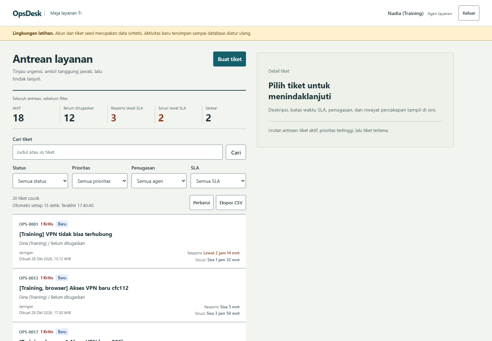
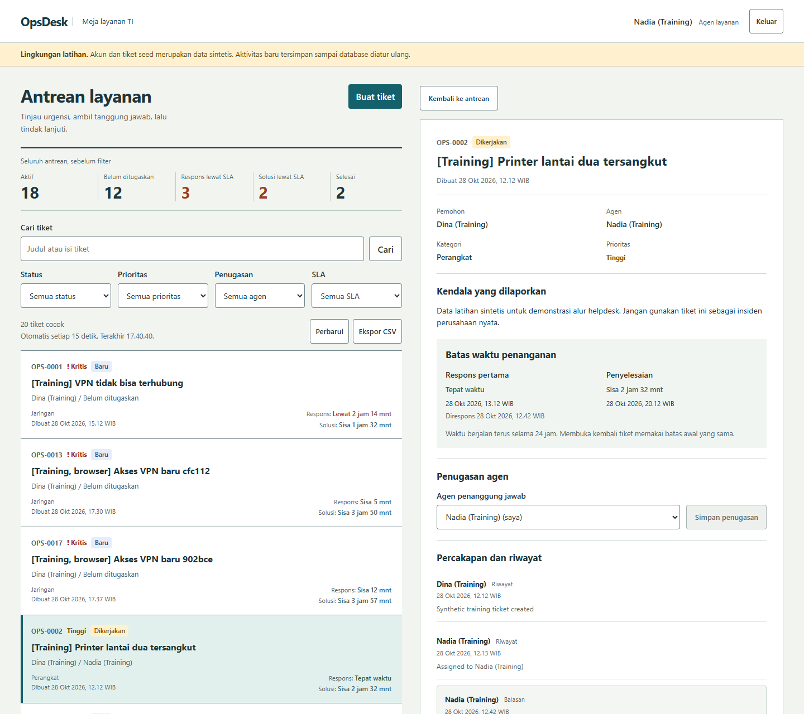
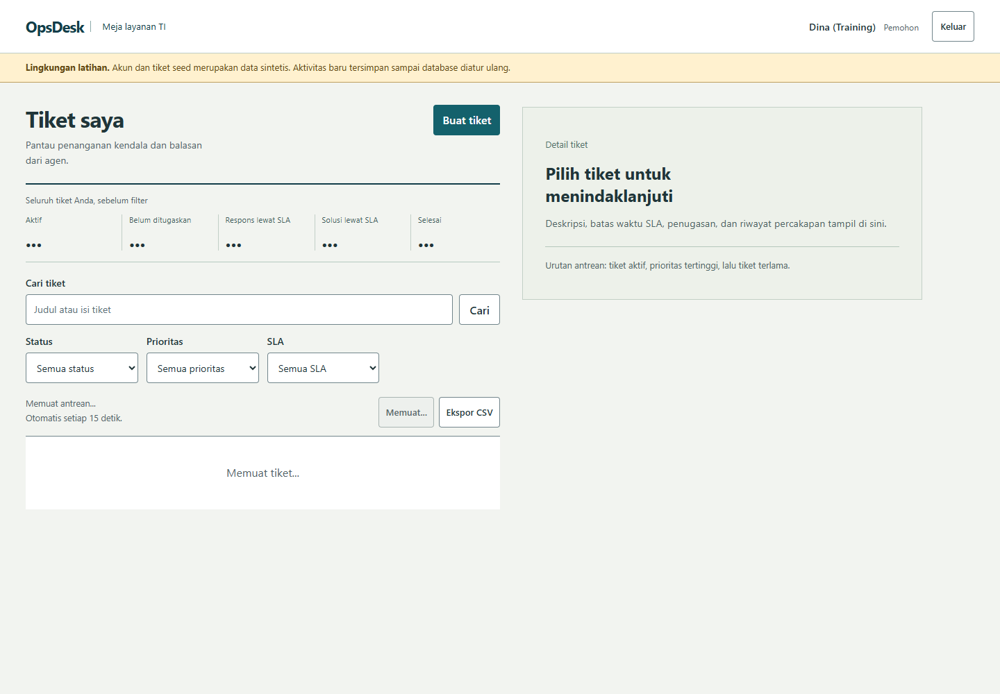
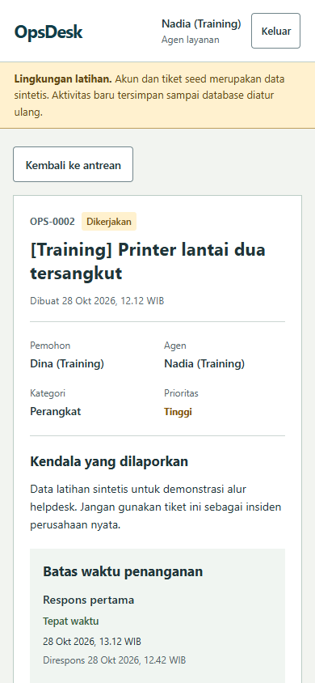
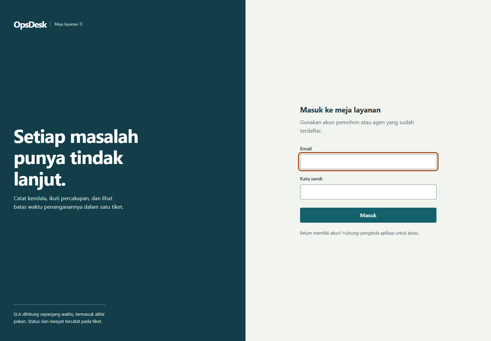

# OpsDesk

Meja layanan IT untuk melaporkan kendala, menugaskan agen, membalas pemohon, dan memantau SLA. Dibuat dengan **FastAPI, React, TypeScript, PostgreSQL, dan Docker**.

Proyek ini berfokus pada hal yang mudah rusak dalam workflow bersama: akses tiket orang lain, catatan internal yang bocor, dua agen menyimpan versi yang sama, serta batas SLA yang berubah ketika tiket dibuka kembali.

## Tampilan aplikasi

Screenshot diambil dari aplikasi yang berjalan dengan PostgreSQL melalui Docker. Semua akun dan tiket yang ditampilkan merupakan data latihan sintetis berlabel `Training`. Angka antrean dihitung dari database saat gambar diambil.





<details>
<summary>Tampilan pemohon, HP, dan login</summary>







</details>

## Menjalankan di Windows

Syarat: Docker Desktop dalam mode Linux containers dan PowerShell. Perintah pertama dapat memerlukan beberapa menit untuk mengunduh image/dependensi.

```powershell
git clone https://github.com/zalamanga/opsdesk-helpdesk.git
cd opsdesk-helpdesk
.\scripts\Start.ps1
```

Buka **http://localhost:8091**. Buka `.local/LOCAL-CREDENTIALS.txt` untuk sandi latihan yang dibuat secara acak pada konfigurasi pertama:

| Akun | Peran |
| --- | --- |
| `agent@opsdesk.test` | Agen utama |
| `agent2@opsdesk.test` | Agen kedua, untuk mencoba perpindahan penugasan |
| `requester@opsdesk.test` | Pemohon |
| `another@opsdesk.test` | Pemohon kedua, untuk memeriksa pembatasan akses |

`.env`, sandi lokal, database, dan hasil tes tidak masuk Git. Seed hanya berjalan sekali dan tidak mereset pekerjaan yang sudah kamu ubah. Mengganti sandi pada `.env` tidak mengganti sandi akun yang sudah tersimpan.

```powershell
.\scripts\Stop.ps1        # Berhenti; volume database tetap tersimpan
.\scripts\Start.ps1 -NoBuild
```

Port hanya dibuka pada loopback komputer. PostgreSQL dan API tidak menerbitkan port host. Lihat [operasi dan konfigurasi](docs/OPERATIONS.md) untuk menjalankan secara manual, membuat akun, atau menyiapkan domain HTTPS.

## Coba satu workflow

1. Masuk sebagai pemohon, pilih **Buat tiket**, jelaskan kendala dan pilih prioritas.
2. Keluar, lalu masuk sebagai agen. Pilih tiket tersebut dan tugaskan kepada diri sendiri.
3. Pilih **Mulai kerjakan**. Tambahkan catatan internal, lalu kirim balasan publik.
4. Isi ringkasan solusi dan pilih **Selesaikan tiket**.
5. Masuk kembali sebagai pemohon. Catatan internal tidak terlihat. Jika kendala berulang, tulis alasan dan pilih **Buka kembali**.

Deadline awal tetap dipakai setelah reopen. Riwayat penyelesaian sebelumnya tetap tercatat. Untuk demo interview yang lebih singkat, ikuti [panduan lima menit](docs/INTERVIEW.md).

## Perilaku yang dapat diperiksa

| Bagian | Perilaku |
| --- | --- |
| Akses | Pemohon melihat tiketnya sendiri; agen melihat antrean. Pembatasan diterapkan pada detail, pencarian, ringkasan, dan ekspor. |
| Percakapan | Balasan publik terlihat oleh kedua pihak. Catatan dan event internal hanya dikirim ke agen. |
| Perubahan bersamaan | Mutasi membawa `expected_version`. Server mengunci baris, membandingkan versi, lalu menyimpan perubahan dan event dalam satu transaksi. Versi lama mendapat HTTP 409. |
| Draf saat konflik | UI mempertahankan teks yang belum dikirim dan meminta pengguna memuat versi terbaru. |
| SLA | Deadline disalin saat pembuatan tiket dan dihitung di server. Balasan publik pertama dari agen selain pembuat tiket memenuhi first response. |
| Pencarian | Filter status, prioritas, penugasan, dan SLA; pagination 10/30/50; pembaruan otomatis setiap 15 detik saat tab terlihat. |
| CSV | Ekspor seluruh hasil filter yang dapat diakses, maksimal 10.000 baris. Nilai yang dapat dibaca sebagai formula spreadsheet diberi awalan pelindung. |
| Sesi | Sandi Argon2, cookie HttpOnly, token sesi opaque yang disimpan sebagai hash, pemeriksaan CSRF dan Origin, serta logout yang mencabut sesi. |

## Aturan SLA

| Prioritas | Respons pertama | Penyelesaian |
| --- | --- | --- |
| Rendah | 8 jam | 72 jam |
| Normal | 4 jam | 24 jam |
| Tinggi | 1 jam | 8 jam |
| Kritis | 15 menit | 4 jam |

Waktu berjalan **24 jam, termasuk malam dan akhir pekan**. Penyelesaian tepat pada deadline masih tepat waktu. Internal note, assignment, balasan pemohon, dan balasan agen pada tiket yang ia buat sendiri tidak memenuhi SLA respons. Ringkasan SLA mencakup seluruh tiket yang dapat diakses, sebelum filter, termasuk tiket selesai yang dahulu melewati batas.

## Struktur dan dokumentasi

```text
backend/app/          API, model, sesi, SLA, seed, dan CLI
backend/alembic/      Migrasi skema database
backend/tests/        Tes aturan bisnis, API, akses, dan konflik PostgreSQL
frontend/src/         React, formulir, antrean, detail, dan state UI
deploy/               Build web dan reverse proxy Nginx
scripts/              Menjalankan, menghentikan, dan menguji proyek
e2e/                  Workflow browser dan capture screenshot
docs/                 Arsitektur, penjelasan kode, operasi, dan bukti pengujian
```

- [Arsitektur dan diagram database](docs/ARCHITECTURE.md)
- [Penjelasan file dan fungsi](docs/CODE-GUIDE.md)
- [Kontrak API](docs/API-CONTRACT.md), [OpenAPI lokal](http://localhost:8091/api/docs)
- [Operasi dan konfigurasi](docs/OPERATIONS.md)
- [Demo dan penjelasan interview](docs/INTERVIEW.md)
- [Hasil pengujian dan pemeriksaan UI](docs/VERIFICATION.md)

## Pengujian

```powershell
.\scripts\Test.ps1
# Tes backend memakai database PostgreSQL sementara pada proyek Compose terpisah.

cd frontend
npm ci
npm test
npm run build
cd ..

# Jalankan aplikasi terlebih dahulu. Edge digunakan pada Windows secara default.
npm ci
npm run test:e2e
```

Untuk Chromium di Linux/CI, jalankan `npx playwright install --with-deps chromium` dan atur `PLAYWRIGHT_CHANNEL=chromium`. Workflow browser membuat tiket latihan baru pada instance yang dituju. Gunakan instance lokal/demo, bukan database operasional.

GitHub Actions menjalankan backend dengan PostgreSQL, build dan unit frontend, serta workflow browser pada stack Docker. [Ruang lingkup tes](docs/test-plan.md) dan [bukti hasil](docs/VERIFICATION.md) menjelaskan apa yang sudah diperiksa.

## Batas proyek

Ini aplikasi portfolio dengan satu organisasi dan dua peran. Belum ada pengiriman email, unggahan lampiran, kalender jam kerja, SSO, antivirus berkas, atau pengelolaan banyak tenant. Akun dikelola melalui CLI. Data demo bukan data pelanggan dan proyek ini tidak mengklaim sertifikasi, uptime, atau hasil benchmark produksi.

Lisensi: [MIT](LICENSE).
