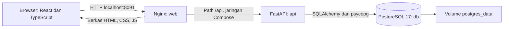
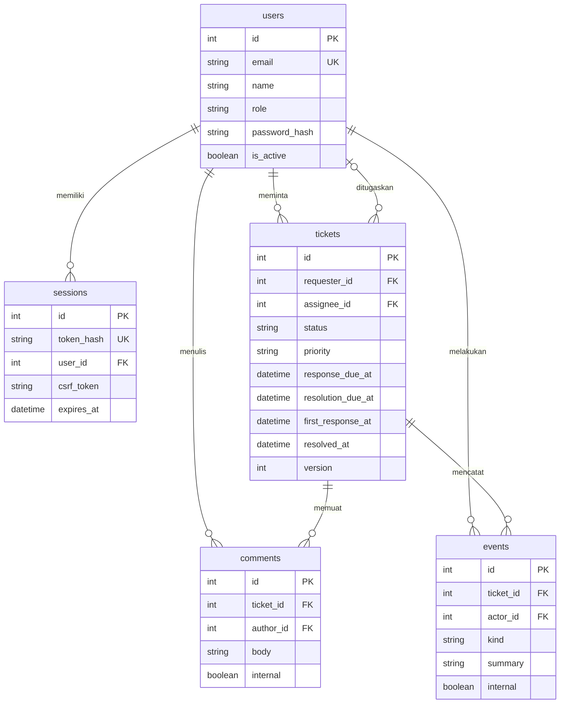
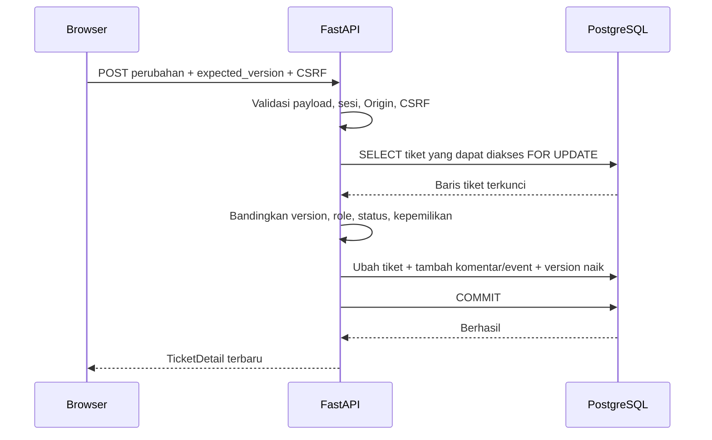

# Arsitektur OpsDesk

OpsDesk mencatat kendala TI, penanggung jawab, percakapan, dan batas waktu penanganannya. Pemohon melihat tiket miliknya. Agen menangani seluruh antrean. Data yang disediakan untuk demo berlabel latihan dan tidak berasal dari insiden perusahaan.

## Susunan layanan

[compose.yml](../compose.yml) hanya membuka layanan web ke `127.0.0.1`, secara bawaan pada port 8091. API dan PostgreSQL berkomunikasi melalui jaringan internal Compose. Nama `db` adalah alamat layanan yang dipakai container API; browser mengakses `/api` melalui Nginx.

Browser menerima hasil build Vite. Pada lingkungan lokal tanpa Docker, [vite.config.ts](../frontend/vite.config.ts) meneruskan `/api` ke server backend. Susunan tersebut mempertahankan pola URL yang sama bagi kode frontend.

[Dockerfile backend](../backend/Dockerfile) mempunyai target runtime dan test. Entrypoint runtime menerapkan migrasi Alembic, menjalankan seed bila diaktifkan, lalu menyalakan Uvicorn dengan satu worker. Health check memeriksa kesiapan database/API sebelum layanan berikutnya dimulai. [web.Dockerfile](../deploy/web.Dockerfile) membangun frontend memakai Node dan menyajikan hasilnya melalui Nginx.

## Model data

Detail kolom dan batas database ada di [models.py](../backend/app/models.py). `assignee_id` boleh kosong. Indeks mendukung pencarian antrean dan relasi tiket. Constraint database membatasi nilai role, status, kategori, prioritas, serta versi minimal satu. `UTCDateTime` menolak datetime tanpa zona waktu dan mengembalikan nilai UTC.

Dua tabel pendukung tidak tergambar pada relasi bisnis: `rate_limit_buckets` menyimpan hitungan percobaan login per jendela waktu, sedangkan `seed_markers` menandai seed latihan yang sudah selesai. Alembic menyimpan revisi skema pada tabel pengelolaannya sendiri.

## Login, cookie, dan akses

1. `POST /api/auth/login` memvalidasi JSON dan Origin bila header tersebut dikirim. Pembatas login menghitung percobaan berdasarkan IP dan email. Nilai bawaan mengizinkan 64 percobaan per IP dan 8 per email dalam jendela tetap 15 menit; percobaan berhasil ikut dihitung.
2. Backend memeriksa hash Argon2 password. Respons gagal menggunakan pesan umum untuk email/password yang tidak cocok.
3. Backend membuat token acak. Browser menerima token melalui cookie `opsdesk_session`; database menyimpan SHA-256 token pada `sessions.token_hash`.
4. Cookie memakai `HttpOnly`, `SameSite=Lax`, dan path `/api`. `Secure` diatur melalui konfigurasi agar demo HTTP lokal dapat berjalan. Nilai bawaan masa sesi adalah 24 jam sejak login dan tidak diperpanjang setiap request.
5. `GET /api/auth/me` memulihkan pengguna dan token CSRF saat halaman dimuat. Frontend menyimpan token CSRF di memori modul `api.ts`. Token sesi tetap berada pada cookie HttpOnly.
6. Request perubahan membutuhkan `X-CSRF-Token` yang cocok dengan sesi. Middleware menolak Origin di luar daftar tepat dan `Sec-Fetch-Site: cross-site`.
7. Logout menghapus sesi dari database serta cookie. Menyalin cookie yang sudah dicabut tidak memulihkan sesi tersebut.

Aturan akses diterapkan di query backend melalui `accessible()` dan `load_ticket()`, kemudian diikuti pemeriksaan role dan kepemilikan tugas. Detail tiket yang tidak dapat diakses menghasilkan 404. `ticket_detail()` membuang catatan serta event internal untuk pemohon. Menyembunyikan tombol pada frontend membantu penggunaan; keputusan akses tetap dilakukan backend.

Cookie HttpOnly membatasi pembacaan token oleh JavaScript. Aplikasi masih perlu mencegah XSS, mengatur HTTPS, serta melindungi konfigurasi dan database. Rancangan ini tidak menyatakan bahwa satu atribut cookie menyelesaikan seluruh risiko keamanan.

## Satu perubahan tiket sebagai satu transaksi

`locked_ticket()` memakai `SELECT ... FOR UPDATE` untuk mengatur penulisan bersamaan pada satu tiket. Kunci baris PostgreSQL menahan penulis lain sampai transaksi selesai. [Dokumentasi PostgreSQL 17](https://www.postgresql.org/docs/17/explicit-locking.html#LOCKING-ROWS) menjelaskan perilaku kunci tersebut.

`expected_version` menyampaikan versi yang dipakai pengguna saat menyusun tindakan. Contohnya, dua agen membaca versi 4. Agen pertama berhasil dan tiket menjadi versi 5. Agen kedua yang masih mengirim versi 4 menerima 409. Kunci baris mengatur urutan penulisan; pemeriksaan versi mendeteksi keputusan yang dibuat berdasarkan data lama.

Model `Ticket` juga mengaktifkan `version_id_col`. Saat ORM memperbarui tiket, SQLAlchemy memeriksa versi yang dibaca sebelumnya. `commit_ticket()` menaikkan versi secara eksplisit dan mengubah konflik ORM menjadi 409. Pemeriksaan ORM ini berlaku pada flush objek, bukan pada semua kemungkinan SQL langsung atau bulk update. [Dokumentasi version counter SQLAlchemy](https://docs.sqlalchemy.org/en/21/orm/versioning.html) menjelaskan batas tersebut.

Tiket, komentar, dan event masuk melalui transaksi yang sama. Kegagalan sebelum commit membatalkan ketiganya. Event merupakan catatan aplikasi biasa; rancangan ini belum menyediakan tanda tangan kriptografis atau perlindungan terhadap administrator database yang mengubah riwayat.

SQLite dipakai untuk pengujian perilaku yang terisolasi. Bukti kunci baris PostgreSQL harus datang dari pengujian PostgreSQL, bukan dari kelulusan SQLite.

## SLA dan pembaruan layar

Kebijakan dalam [sla.py](../backend/app/sla.py) menghitung waktu terus-menerus dalam UTC. Hari libur, akhir pekan, dan status dikerjakan tidak menjeda hitungan.

| Prioritas | Respons pertama | Penyelesaian |
| --- | --- | --- |
| Rendah | 8 jam | 72 jam |
| Normal | 4 jam | 24 jam |
| Tinggi | 1 jam | 8 jam |
| Kritis | 15 menit | 4 jam |

Backend menyimpan kedua deadline saat tiket dibuat. Aplikasi tidak menyediakan perubahan prioritas/deadline setelah pembuatan. Komentar publik pertama dari agen yang bukan pemilik permintaan memenuhi respons pertama; penugasan, catatan internal, dan komentar pemilik permintaan tidak memenuhinya. Aturan ini juga berlaku ketika agen membuat tiket untuk dirinya sendiri. Catatan penyelesaian publik dari agen lain juga dapat menjadi respons pertama.

`snapshot()` menghasilkan `pending`, `met`, atau `breached`. Penyelesaian tepat pada deadline masih `met`. Tiket belum selesai yang tepat berada pada deadline masih `pending`; setelah deadline menjadi `breached`. `remaining_seconds` memakai selisih deadline dengan waktu sekarang untuk pekerjaan belum selesai, atau dengan waktu penyelesaian untuk pekerjaan yang sudah selesai.

Reopen menghapus `resolved_at` saat ini, mempertahankan deadline awal dan `first_response_at`, serta menambahkan komentar alasan dan event. Karena deadline tidak diulang, tiket yang dibuka lagi dapat langsung melewati SLA penyelesaian.

Frontend mengambil antrean/detail setiap 15 detik ketika tab terlihat dan menyediakan tombol perbarui. Ini polling HTTP, bukan WebSocket. Backend memakai satu nilai waktu untuk seluruh perhitungan SLA dalam satu respons antrean/detail. Frontend hanya memformat waktu menjadi tampilan lokal browser.

Ringkasan antrean mencakup seluruh tiket yang dapat diakses sebelum filter. Hitungan respons/solusi lewat SLA mencakup riwayat penyelesaian terlambat, termasuk tiket selesai. Daftar hasil tetap mengikuti filter dan pagination. Export mengambil seluruh hasil filter, dengan penolakan bila jumlahnya melebihi 10.000 baris.

## Batas implementasi

OpsDesk belum mempunyai multi-tenant, SSO, MFA, reset password mandiri, email, unggahan, notifikasi antrean, kalender jam kerja, billing, atau fitur AI. Pembuatan akun dilakukan operator melalui CLI. Data latihan disimpan sampai database dikelola ulang; seed berikutnya tidak menghapus atau mereset transaksi pengguna.

Compose menjalankan satu instance aplikasi dan satu database dengan volume lokal. Replikasi database, pengujian beban, pemulihan backup terjadwal, observability terpusat, dan target availability belum menjadi bukti proyek ini. Batas memori container membantu demo lokal; nilainya bukan hasil penentuan kapasitas produksi.

Pembatas login memakai `request.client.host`. Saat aplikasi dipublikasikan di balik reverse proxy, operator perlu menetapkan sumber IP dan trusted proxy dengan benar agar pembatasan berbasis IP sesuai topologi. [Panduan proxy FastAPI](https://fastapi.tiangolo.com/advanced/behind-a-proxy/) menjelaskan kepercayaan header penerusan. Konfigurasi demo lokal tidak boleh dianggap sebagai konfigurasi publik yang sudah diaudit.

Kontrak respons dan aturan error ada di [API-CONTRACT.md](API-CONTRACT.md). Penjelasan kode per file ada di [CODE-GUIDE.md](CODE-GUIDE.md).
